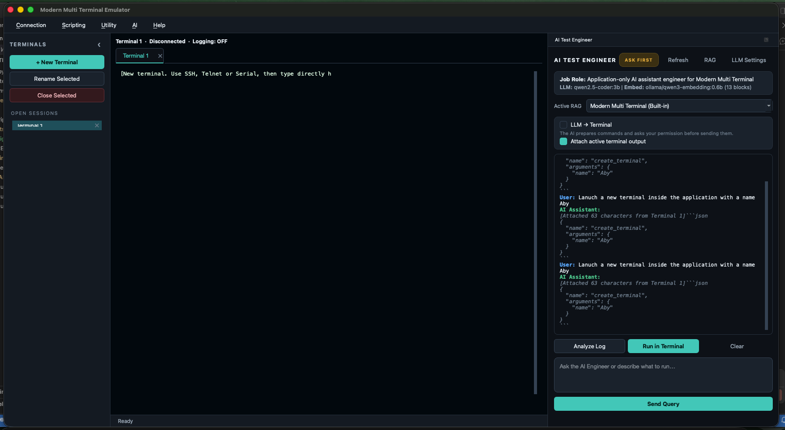

<div align="center">

# ⚡ Modern Multi Terminal Emulator
### & DevOps Sequencer Suite

**A cross-platform automation workbench, drop-in Tera Term replacement and AI-assisted test-engineering terminal.**

[](https://www.python.org/)
[](https://www.riverbankcomputing.com/software/pyqt/)
[]()
[]()
[](LICENSE.txt)

---

</div>

## 📖 Overview

Network SREs and hardware developers are constantly forced to choose between **writing modern Python automation** and **supporting legacy Tera Term (`.ttl`) infrastructure**.

**Modern Multi Terminal** bridges the gap. It runs concurrent multi-protocol live sessions alongside a **DAW-style automation sequencer**, so teams can execute mixed legacy macros and Python scripts in one interface. An integrated **AI Test Engineer** can read your terminals, propose commands and, when you allow it, type them straight into the terminals you pick.

---

## 🆕 What's New

* **One-click launch.** `run_windows.bat`, `run_mac.command` and `run.sh` find Python, create `.venv`, install the dependencies and start the app. See [Quickstart](#-quickstart-guide).
* **Built-in text editor.** A Notepad++-style editor with tabs, line numbers, syntax colouring, find / replace and go to line. Double-click a file in the SFTP browser to edit it, or type `vim file` / `nano file` in an SSH terminal and it opens there instead.
* **Record Actions | Macro.** Record the commands you type in a terminal, with the time between them, and get a ready-to-run Python script. A blinking **REC** badge shows while recording.
* **Terminal syntax highlighting.** Prompts, IPs, MAC addresses, URLs, paths, errors, warnings and numbers are coloured. Colours sent by the remote host always win.
* **Faster terminal handling.** A **+** button next to the tabs opens a new terminal (also **Ctrl+Shift+T**), and you can double-click a tab to rename it in place.
* **Saved Profiles editor.** Add, edit, connect and delete SSH and Telnet profiles from **Utility → Saved Profiles**.
* **Cleaner DAW Suite rows.** Run, move and remove buttons are drawn to match the dark theme.
* **Launch splash, AI panel closed by default.** A splash screen shows while the app loads, and the AI window opens only when you ask for it (**AI → AI Assistant Window**).
* **LLM → Terminal modes.** One checkbox decides whether the AI acts on its own (**AUTO-RUN**) or asks first (**ASK FIRST**). See [AI Test Engineer](#-ai-test-engineer).
* **No terminal needs to be open first.** With AUTO-RUN on, the AI opens a tab if none exists. If no tab is connected, it asks you to connect one instead of dropping the command.
* **Run in Terminal picker.** One dialog to review or edit commands, tick the target terminals, connect a tab or open a new one, and send.
* **Multi-terminal sending.** Commands can go to the current tab, a named tab, several tabs or all connected tabs, and the real output is passed back to the AI.
* **Always-dark professional UI.** The app no longer follows the system theme. It uses a single dark palette, a token-based stylesheet and consistent buttons, tabs, dialogs and menus.
* **Redesigned close buttons.** Terminal tabs and the sidebar use a crisp drawn "x" that is muted at rest and turns red on hover.
* **Many LLM providers.** OpenAI, Anthropic, Gemini, Groq, Mistral, DeepSeek, xAI, OpenRouter, Together AI, Ollama, LM Studio and local GGUF files.

---

## ✨ Engineering Highlights

### 🔌 Tri-Protocol Connection Engine
* **SSH-2:** Fully allocated PTY interactive shell streams powered by `paramiko`.
* **Hardware Serial:** Native `pyserial` bridge with live hardware discovery *(friendly driver names such as `CP210x USB to UART Bridge (COM6)` instead of raw system paths)*.
* **Telnet:** Raw TCP socket engine with an automated background scrubber that strips binary `IAC (0xFF)` negotiation spam.
* **SFTP Browser and Hops:** Browse and transfer files between two systems, including jump-host (hop) chains.

### 🧠 VT100 Terminal Emulation
* **True Stream Emulation:** Output is rendered through a `pyte` screen with scrollback and a real caret.
* **Anti-Bell Trap:** Silently drops rogue `\x07 (BEL)` packets before they can disturb screen geometry or capture buffers.
* **Per-session Logging:** Start, pause and stop logging for each tab.

### 📝 Built-in Text Editor
Open it from **Utility → Text Editor**, by double-clicking a file in the SFTP browser, or by typing `vi`, `vim`, `nano` (also with `sudo`) in an **SSH** terminal.
* Tabs, line numbers, current-line highlight, auto-indent, word wrap, zoom (**Ctrl + wheel**) and show whitespace.
* Syntax colouring for Python, Bash, YAML, JSON, INI, XML, Tera Term macros, logs and more. The language is picked from the file name or shebang, and you can change it from the **Language** menu.
* **Ctrl+F** find, **Ctrl+H** replace (match case, whole word, regex), **Ctrl+G** go to line, **Ctrl+D** duplicate line, **Ctrl+/** toggle comment.
* Line endings (LF / CR LF) and encoding are kept when saving. Remote files are saved straight back over SFTP.
* How the terminal hand-off works: the typed command is cleared from the remote prompt, the shell's working directory is read so relative paths work, and the file opens in the editor. A file that does not exist yet opens empty and is created when you save. If the file cannot be opened (for example no read permission), you are asked whether to run the command in the terminal instead. Turn this off with **Utility → Open vi / vim / nano in Built-in Editor**. Telnet and serial terminals are never intercepted.

### ⏺️ Macro Recorder
1. **Utility → Record Actions | Macro...**, pick the terminal and click **Record Macro**.
2. Work as usual. The tab shows a `●`, and the header shows a blinking **REC** badge with the time and number of commands.
3. **Utility → Stop Macro Recording** (or the same dialog). Save the generated `.py` file. It opens in the editor so you can review it.

The script replays each command with `send()` and waits with `pause()` as long as you did. Set `TIMING_SCALE` at the top to replay faster. Anything typed at a password prompt is **not** stored, and the script asks for it with `input()` when it runs. Commands recalled with the arrow keys or tab completion are read back from the screen. Run the macro with **Scripting → Run Script** or add it to the Multi-Script Suite.

### 🎛️ DAW Multi-Script Sequencer
* **Session Tab Routing:** Assign Row 1 (`login.ttl`) to *Terminal A* and Row 2 (`scrape_routing_table.py`) to *Terminal B*. The GUI follows the active execution.
* **Smart Prompt Sniffer:** A background regex engine hunts for prompt signifiers (`$`, `#`, `>`) to advance queue steps hands-free.
* **The Operator Gate:** If a script times out or throws an exception, execution freezes and raises an OS audio alert, offering `[+15s Extend]`, `[Force Pass]` or `[Abort]`.
* **Single-Bench Debugger:** Test one row in isolation with its **Run** button.

---


## 🤖 AI Test Engineer

Open the AI panel from the **AI** menu. The assistant reads your terminal scrollback, answers questions about the app and your project, and can act on terminals through validated application tools. It never launches macOS Terminal or another external shell. Everything runs in the app's own tabs through the built-in Python script engine.

### LLM → Terminal modes

| Checkbox | Badge | Behaviour |
|---|---|---|
| Checked | `AUTO-RUN` | The AI decides what to run and sends the commands straight to the terminal. If no tab exists it opens one. If no tab is connected it asks you to connect one. Output is read back and summarised. |
| Unchecked | `ASK FIRST` | The AI only prepares the commands. A permission dialog lists them (editable) and asks which terminals to use. Nothing is sent until you approve. |

The choice is saved between launches. Analyze Log and advice-style questions never send anything in either mode.

### Run in Terminal

Click **Run in Terminal** to send the AI's latest commands yourself:

1. A dialog lists the commands from the latest answer. You can edit or remove lines.
2. Every open terminal is listed, and connected ones are ticked. Select one or several.
3. If a tab is not connected, connect it from the dialog. You can also open a new terminal there.
4. Choose the delay between commands and press **Run** (**Don't run** when approving AI commands). Output from each terminal is returned to the AI for a summary.

### Application tools available to the model

`list_terminals`, `read_terminal`, `create_terminal`, `rename_terminal`, `connect_terminal` and `send_terminal`. The target of `send_terminal` can be `current`, a tab name, several comma-separated names, or `all`. Tool calls are validated and executed by the existing script engine. Models that return JSON tool requests as plain text instead of native tool calls are also supported, and an identical action is never run twice in a row.

### Providers and settings

Open **AI → LLM Settings** to pick a provider, endpoint, model and API key.

| Backend | Providers |
|---|---|
| OpenAI-compatible | OpenAI, Google Gemini, Groq, Mistral, DeepSeek, xAI (Grok), OpenRouter, Together AI, LM Studio |
| Native | Anthropic, Ollama |
| In-process | Local GGUF file (`pip install -r requirements-gguf.txt`) |

* **Local Ollama:** choose **Ollama (Local)** and set an installed model such as `llama3.1` or `qwen2.5:7b`. The default endpoint is `http://localhost:11434`.
* **API keys** can be entered in the dialog or read from the provider's environment variable, for example `OPENAI_API_KEY` or `ANTHROPIC_API_KEY`.
* **Attach Active Terminal Output Buffer** adds recent scrollback from the selected tab to each prompt. Passwords and tokens are masked before output is sent to a cloud model (the privacy option in LLM Settings, on by default).
* **Stop** cancels an in-progress request.

### Project RAG memory

The app creates a read-only **Modern Multi Terminal (Built-in)** memory that documents its own architecture, script engine, connections, logging, DAW playlist, SFTP hops and AI tool flow. It is combined with any project RAG you select, never replaced by it. Embeddings are cached and relevant passages are chosen per query. If the embedding endpoint is unavailable, keyword retrieval is used. Manage your own memories under **AI → Manage Project RAG Memories**.

---

## 🏗️ Modular System Architecture

```text
modern_multi_terminal/
│
├── assets/                      # App branding & screenshots
├── Scripts/                     # Sample scripts
│   ├── python/                  #   Python automation examples
│   └── ttl/                     #   Tera Term macro examples
│
├── core/
│   ├── models.py                # Session state tracking, pyte screen, scrollback, logging
│   ├── connections.py           # Threaded SSH, Serial and Telnet drivers
│   ├── script_engine.py         # Tera Term (.ttl) interpreter & Python exec() global hooks
│   ├── sftp_hops.py             # SSH hop / jump-host chains for SFTP
│   ├── profile_store.py         # Saved connection profiles
│   ├── app_settings.py          # Persisted UI preferences (highlighting, editor options)
│   ├── terminal_highlight.py    # Regex syntax highlighting for terminal output
│   ├── macro_recorder.py        # Macro recording -> Python script; command-line parsing
│   ├── presets.py               # Embedded sample macro repository
│   ├── theme.py                 # Terminal colours and palette
│   ├── qt_theme.py              # Application-wide dark palette and fonts
│   ├── terminal_dispatch.py     # Qt-free command parsing, target resolution, approval queue
│   ├── llm_chat.py              # Chat orchestration with application tools
│   ├── llm_config.py            # LLM settings persistence
│   ├── rag_manager.py           # Project RAG memories
│   ├── application_knowledge.py # Built-in app documentation used by RAG
│   ├── redact.py                # Secret redaction for attached output
│   └── llm/                     # Provider backends
│       ├── providers.py         #   Provider registry
│       ├── factory.py           #   Backend selection
│       ├── openai_backend.py    #   OpenAI-compatible APIs
│       ├── anthropic_backend.py #   Anthropic
│       ├── ollama_backend.py    #   Ollama
│       ├── gguf_backend.py      #   Local GGUF models
│       ├── embeddings.py        #   Embedding clients
│       ├── agent.py             #   Tool-calling loop
│       ├── tools.py             #   Application tool schemas
│       ├── settings.py          #   Settings model
│       └── errors.py
│
├── gui/
│   ├── main_window.py           # Main window, tabs, sidebar, menus
│   ├── ai_assistant_panel.py    # AI Test Engineer panel and LLM → Terminal logic
│   ├── run_terminal_dialog.py   # Terminal picker / approval dialog
│   ├── close_button.py          # Drawn close ("x") button for tabs and sidebar
│   ├── icons.py                 # Vector icons drawn for the dark theme
│   ├── text_editor.py           # Built-in Notepad++-style editor (local + SFTP files)
│   ├── macro_dialog.py          # Record Actions | Macro dialog
│   ├── ui_style.py              # Dark design tokens and application stylesheet
│   ├── terminal_widget.py       # Terminal rendering and input
│   ├── dialogs.py               # Connection builders, Rename, Help
│   ├── daw_manager.py           # DAW playlist sequencer
│   ├── sftp_dialog.py           # SFTP browser with hop support
│   ├── profiles_dialog.py       # Saved profile manager
│   ├── llm_settings_dialog.py   # LLM provider settings
│   ├── rag_dialog.py            # RAG memory manager
│   ├── session_label.py         # Sidebar session rows, inline tab rename
│   └── helpers.py
│
├── tests/                       # Headless pytest suite (see tests/README.md)
├── pytest.ini
├── main.py                      # Application entry point and splash screen
├── run.sh                       # One-step setup + launch (macOS / Linux)
├── run_mac.command              # Double-click launcher for macOS Finder
├── run_windows.bat              # One-step setup + launch (Windows)
├── LICENSE.txt                  # BSD 3-Clause License
├── requirements.txt             # Runtime dependencies
├── requirements-test.txt        # Test dependencies
└── requirements-gguf.txt        # Optional local GGUF support
```

---

## 🚀 Quickstart Guide

### 1. One-click launch (recommended)

| System | What to run |
|---|---|
| Windows | Double-click **`run_windows.bat`** |
| macOS | Double-click **`run_mac.command`** (or run `./run.sh` in Terminal) |
| Linux | `./run.sh` |

On the first run the script finds Python 3.10+, creates a private `.venv` folder next to the app, installs `requirements.txt` and starts the app. Later runs start straight away. Dependencies are reinstalled only when `requirements.txt` changes. Nothing outside the app folder is changed.

* Windows: if Python is missing, the script offers to install Python 3.12 with `winget`.
* macOS / Linux: if Python is missing, the script prints the install command for your system. On Linux it also warns when Qt's `libxcb-cursor0` library is missing.
* Options: `--gguf` also installs local GGUF support, `--reinstall` rebuilds `.venv` from scratch, `--setup-only` prepares everything without starting the app.

> macOS may block the first double-click on a downloaded file. Right-click `run_mac.command`, choose **Open**, then confirm.

### 2. Manual installation

**Python 3.10 or higher** on Windows, macOS or Linux.

```bash
git clone https://github.com/abyshergill/MMTE.git
cd MMTE

python -m venv .venv
source .venv/bin/activate        # Windows: .venv\Scripts\activate
pip install -r requirements.txt
```

Runtime dependencies include `PyQt6`, `paramiko`, `pyserial`, `pyte`, `Pygments` and `requests`.

### 3. Launch

```bash
python main.py
```

The application always starts in the dark theme, regardless of the operating-system setting.

### 4. First AI session

1. Open **AI → LLM Settings** and choose a provider, model and key.
2. Open a terminal and connect it (**Connection → SSH / Telnet / Serial**).
3. In the AI panel, choose the mode with the **LLM → Terminal** checkbox and send a request such as `check the uptime on this device`.

---

## 🧪 Testing

```bash
pip install -r requirements-test.txt
pytest
```

The suite runs headless (`QT_QPA_PLATFORM=offscreen`) and needs no display, network or hardware. `tests/test_terminal_dispatch.py` covers the Qt-free dispatch logic and can run without PyQt6. See [tests/README.md](tests/README.md) for details.

---

## 📜 Automation Syntax Reference

Both formats can sit side by side in the same Multi-Script playlist.

### Option A: Tera Term Macro (`.ttl`)

```ini
; login_sequence.ttl
Prompt = '#'

connect '192.168.1.50 /telnet /port=23'
wait 'login:'
sendln 'admin'

wait 'Password:'
sendln 'supersecret'

wait Prompt
sendln 'show system uptime'
end
```

### Option B: Native Python (`.py`)

```python
# login_sequence.py

connect_telnet("192.168.1.50", port=23)
wait(1.0)

send("admin")
wait(0.5)

send("supersecret")
wait(1.0)

send("show system uptime")
print("--- Automated Diagnostic Complete ---")
```

#### Injected Python globals

* `connect_ssh(host, username, password, port=22)`
* `connect_serial(port, baudrate, bytesize=8, parity="N", stopbits=1)`
* `connect_telnet(host, port=23)`
* `wait_connected(...)`
* `send(text, newline=True, delay=0.0)`
* `print(text)`: writes to the terminal
* `wait(seconds)` / `sleep(seconds)`
* `log_on(...)` / `log_off()`
* `alert(...)` / `input(...)`
* `terminal_new(name)`, `terminal_select(name)`, `terminal_rename(current, new)`, `terminal_close(name)`, `terminal_list()`
* `run_script(path)`
* `terminal_name`: the name of the current terminal

More examples are in `Scripts/python` and `Scripts/ttl`.

---

## 📂 Local System Directories

Settings and logs live under the user's home directory:

* **Configuration folder:** `~/.modern_multi_terminal_emulator/`
* **SSH and Telnet profiles:** `ssh_profiles.json`, `telnet_profiles.json`
* **Session logs:** `logs/*.log`
* **Recorded macros:** `macros/*.py` (default save location)
* **UI preferences:** `app_settings.json` (syntax highlighting, editor interception, editor wrap and font size)
* **LLM settings:** `llm_config.json` in the same folder, including the saved LLM → Terminal mode

---

## 🛡️ License & Contact

Distributed under the **BSD 3-Clause License**. See `LICENSE.txt` for more information.

**Project Architect:** DevOps Suite Development Team

*Found a bug or need an enterprise protocol scraper added?* **[Open an issue or reach out to the creator ↗](https://github.com/abyshergill/MMTE)**
