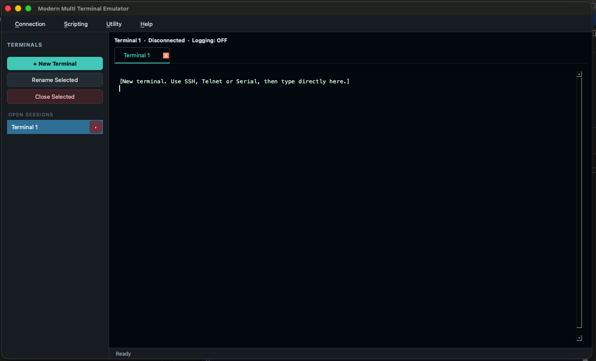

<div align="center">

# ⚡ Modern Multi Terminal Emulator 3.0
### & DevOps Sequencer Suite

**The next-generation, cross-platform automation workbench & drop-in Tera Term replacement.**

[](https://www.python.org/)
[](https://github.com/TomSchimansky/CustomTkinter)
[]()
[](LICENSE)

---

</div>

## 📖 Overview

Network SREs and hardware developers are constantly forced to choose between **writing modern Python automation** and **supporting legacy Tera Term (`.ttl`) infrastructure**. 

**Modern Multi Terminal** bridges the gap. It is an enterprise-grade workbench that runs concurrent multi-protocol live sessions alongside a **Digital Audio Workbench (DAW)-style automation sequencer**—allowing teams to execute mixed legacy macros and Python scripts inside a unified, strobe-free interface.

---

## ✨ Engineering Highlights

### 🔌 Tri-Protocol Connection Engine
* **SSH-2:** Fully allocated PTY interactive shell streams powered by `paramiko`.
* **Hardware Serial:** Native `pyserial` bridge with live hardware discovery *(displays friendly driver names like `CP210x USB to UART Bridge (COM6)` rather than raw system paths)*.
* **Telnet:** Raw TCP socket engine featuring an automated background regex scrubber that strips binary `IAC (0xFF)` negotiation spam.

### 🧠 Sane VT100 Stream Caret 
* **True Stream Emulation:** Incoming packets insert strictly at the local green caret position (`"insert"`), never forcibly snapping the user's cursor to the bottom of the screen mid-sentence.
* **Anti-Bell Trap:** Silently vaporizes rogue Linux `\x07 (BEL)` audio packets before they can corrupt screen geometry or sniffer buffers.
* **Zero-Flicker Layout:** Fully decoupled widget memory arrays; tabs and scroll views mutate existing Tkinter properties rather than running `.destroy()` redraw loops.

### 🎛️ DAW Multi-Script Sequencer
* **Session Tab Routing:** Assign Row 1 (`login.ttl`) to *Terminal A*, and Row 2 (`scrape_routing_table.py`) to *Terminal B*. The GUI auto-flips tabs to follow active execution.
* **Smart Prompt Sniffer:** Background regex engine hunts for prompt signifiers (`$`, `#`, `>`) to graduate queue steps hands-free.
* **The Operator Gate:** If a script times out or throws an exception, execution freezes and triggers an OS audio alert, offering the engineer three choices: `[+15s Extend]`, `[Force Pass]`, or `[Abort]`.
* **Single-Bench Debugger:** Test Row 4 in isolation using the `► Single` button without waiting for Rows 1–3 to execute.

---


## 🏗️ Modular System Architecture

```text
modern_multi_terminal/
│
├── assets/                      # App branding & window taskbar resolution 
├── Scripts/                     # This contain sample scripts for tega term and python
│
├── core/
│   ├── __init__.py              
│   ├── models.py                # Session state tracking & VT100 Textbox mutations
│   ├── connections.py           # Threaded SSH, Serial, and Telnet socket drivers
│   ├── script_engine.py         # Legacy .ttl Tokenizer & Python exec() global hooks
│   ├── qt_theme.py              # Contain theme for the applicaiton
│   └── presets.py               # Static embedded macro download repository
│   └── theme.py                 # Contain terminal theme and pallet
│   └── sftp_hops.py             # for addition sshp hop jumper
│
├── gui/
│   ├── __init__.py              
│   ├── dialogs.py               # Modal views (Connection builders, Rename, Help)
│   └── daw_manager.py           # DAW Playlist Sequencer & Supervisor Engine
│   └── sftp_dialog.py           # UI for the jumper connection and file transfer between two systems
│   └── terminal_widget.py       # Contain how to render the text on the terminal
|
├── tests/                       # Contain test for this applicaiton and readme file.
├── pytest.ini                   # For testing 
|
├── main.py                      # Application Start file
|
├── LICENSE.txt                  # BSD License 3 Clause
└── requirements.txt

```

---

## 🚀 Quickstart Guide

### 1. Requirements

Ensure you have **Python 3.10 or higher** installed on Windows, macOS, or Linux.

### 2. Installation

Clone the repository and install the 3 lightweight core dependencies:

```bash
git clone https://github.com/abyshergill/modern_multi_terminal.git
cd modern_multi_terminal

pip install -r requirements.txt
```

### 3. Launch

```bash
python main.py

```

### Local LLM in the AI Test Engineer

Open **AI → LLM Settings**, choose **Ollama (Local)**, and set the model name to an installed Ollama model (for example, `llama3.1` or `qwen2.5:7b`). The default Ollama-compatible endpoint is `http://localhost:11434/v1`. OpenAI-compatible local servers can use their own base URL, such as `http://localhost:1234/v1`; Ollama's native endpoint ending in `/api/chat` is also accepted.

The AI panel streams answers and its **Stop** button cancels an in-progress request. With **Attach Active Terminal Output Buffer** enabled, each prompt includes recent scrollback from the selected embedded session. The assistant retrieves relevant app and project instructions before answering. Advice-only questions do not receive mutation tools. Explicit requests to create/rename/connect tabs or send terminal input use application tools and the built-in automation engine; they do not launch macOS Terminal or another shell.

The app automatically creates a read-only **Modern Multi Terminal (Built-in)** RAG memory and selects it by default. It documents the actual app/session architecture, script engine, connection requirements, terminal output/logging, DAW playlist, SFTP hops, and AI tool flow. It is combined with a selected project RAG, not replaced by it. The Ollama embedding model is `qwen3-embedding:0.6b`; embeddings are cached and relevant passages are selected per query. If Ollama's embedding endpoint is unavailable, keyword retrieval is used. The built-in memory is visible but protected from edits in **Manage Project RAG Memories**.

The selected Ollama chat model receives structured application tools (`create_terminal`, `rename_terminal`, `connect_terminal`, `send_terminal`, `read_terminal`, and `list_terminals`) plus current tab/connection state and retrieved app-specific knowledge. Tool calls are validated, executed by the existing Python script engine, and actual app output is sent back to Ollama for its final response. Mutating tools are only exposed when the current user message requests the corresponding operation. Qwen models that return JSON tool requests as message content instead of native `tool_calls` are also supported; repeated identical actions are not run twice. Configure the response model and Ollama base URL under **AI → LLM Settings**; the embedding model is configured in the built-in RAG memory.

---

## 📜 Automation Syntax Reference

The suite natively parses both formats side-by-side. You can drag both file types into the same Multi-Script playlist.

### Option A: Tera Term Macro (`.ttl`)

*Fully supports standard TTL runtime variables, inline comments, and termination hooks.*

```ini
; login_sequence.ttl
Prompt = '#'

connect '192.168.1.50 /telnet /port=23'
wait 'login:'
sendln 'admin'

wait 'Password:'
sendln 'supersecret'

wait Prompt
sendln 'show system uptime'
end

```

### Option B: Native Python (`.py`)

*Exposes injected global thread hooks directly to your standard Python code.*

```python
# login_sequence.py

# Programmatic socket handoff
connect_telnet("192.168.1.50", port=23)
wait(1.0)

send("admin")
wait(0.5)

send("supersecret")
wait(1.0)

send("show system uptime")
print("--- Automated Diagnostic Complete ---")

```

#### Available Injected Python Globals:

* `connect_ssh(host, username, password, port=22)`
* `connect_serial(port, baudrate, bytesize=8, parity="N", stopbits=1)`
* `connect_telnet(host, port=23)`
* `send(text, newline=True, delay=0.0)`
* `wait(seconds)` / `sleep(seconds)`

---

## 📂 Local System Directories

The emulator safely isolates its footprint to the user's home directory:

* **SSH Profiles:** `~/.modern_multi_terminal_emulator/ssh_profiles.json`
* **Stream Session Logs:** `~/.modern_multi_terminal_emulator/logs/*.log`

---

## 🛡️ License & Contact

Distributed under the **BSD 3-Clause License**. See `LICENSE` for more information.

**Project Architect:** DevOps Suite Development Team

*Found a bug or need an enterprise protocol scraper added?* **[Click here to open an Issue or reach out to the Creator ↗](https://github.com/abyshergill)**
